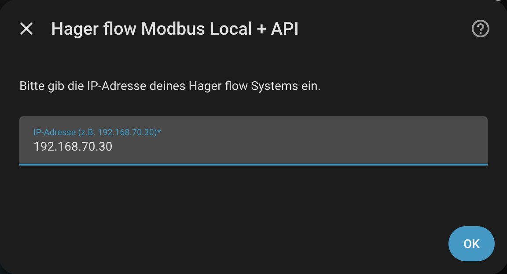
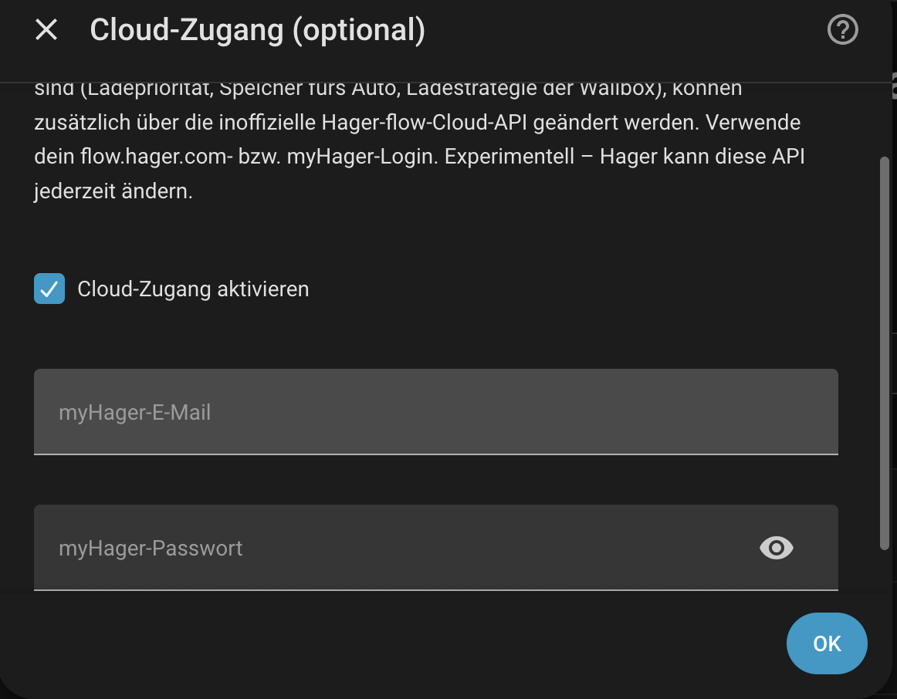

# Hager flow Modbus Local + API — Home-Assistant-Integration

 
🌐 **Unterstützte Systemsprachen:** `English` | `Deutsch` | `Français` | `Nederlands`

Eine moderne, hochoptimierte Home-Assistant-Integration zur lokalen Überwachung und Steuerung deines **Hager flow Energy Management System (EMS / EMC)** über Modbus TCP. Sie verfügt über eine strikte **Auto-Discovery-Engine**, die angeschlossene Hardware automatisch erkennt, dynamisch benennt und dabei offline Geräte herausfiltert, damit deine Entitäten übersichtlich bleiben.

Lesen und der Großteil der Steuerung bleiben **100 % lokal** über Modbus. Darüber hinaus gibt es eine **optionale Cloud-Ebene** (opt-in, standardmäßig aus) für Funktionen, die Hager **nicht** über Modbus beschreibbar macht – Ladepriorität, Entladung des Speichers ins Auto, Ladestrategie je Wallbox, Entladegrenze „bis Ladezustand" und die Notstromreserve. Siehe [Optional: Cloud-Zugang für erweiterte Funktionen](#-optional-cloud-zugang-für-erweiterte-funktionen).

---

## 📋 Voraussetzungen

Um diese Integration zu nutzen, muss dein Setup folgende Mindestanforderungen erfüllen:

### 🔧 Erforderliche Hardware & System-Basis
* **Basis-Controller:** **Hager flow XEM470** Energy Management Controller (EMC).
* **Netzwerkzugang:** Der Controller muss sich im selben lokalen Netzwerk wie deine Home-Assistant-Instanz befinden.
* **IP-Konfiguration:** Eine **statische IP-Adresse** für den Hager-flow-Controller wird dringend empfohlen, um Verbindungsabbrüche zu vermeiden.

### 🔌 Unterstützte optionale Hardware (nur Hager)
⚠️ **Wichtig:** Die integrierte Auto-Discovery-Engine funktioniert nur für **originale Hager-Geräte**, die direkt am System angeschlossen sind.
* **Zähler:** Zusätzliche Hager-Unterzähler (XVA6xx, ECR38xD).
* **Wallboxen:** Hager Witty Ladestationen (flow, solar, plus).
* **Wechselrichter & Speicher:** Angeschlossene, von Hager unterstützte Solar-Wechselrichter (XEM1200) und Batteriespeichersysteme (XEM3x00, XEM4x00).
* **Wärmepumpen:** SG-Ready-Anbindung innerhalb der Systeme.

### ⚙️ Software- & Netzwerkkonfiguration
* **Home Assistant:** Version **2025.12 oder neuer** ist zwingend erforderlich.
* **Modbus TCP:** Muss explizit direkt in deiner **Hager-flow-App** **aktiviert** sein – falls diese Option nicht sichtbar ist, musst du eventuell den Hager-Support kontaktieren, damit sie freigeschaltet wird.
* **Netzwerk-Port:** **Port 502** muss offen und erreichbar sein (prüfe bei Verbindungsproblemen deine Firewall-Einstellungen).

---

## 📋 Funktionen

- ⚡ **Lokal zuerst:** Liest und steuert dein System direkt per Modbus TCP (Port 502) – für den Alltagsbetrieb ist keine Cloud nötig.
- ☁️ **Optionale Cloud-Erweiterungen (opt-in):** Für Einstellungen, die Modbus nicht schreiben kann, ergänzt eine optionale Cloud-Ebene (myHager-Login) die **Ladepriorität**, die **Entladung ins Auto** (Solar- & Boost-Modus), die **Ladestrategie** je Wallbox, **Entladen bis Ladezustand** und die **Notstromreserve** – die letzten beiden sicher gekoppelt (das Limit fällt nie unter die Reserve). Standardmäßig aus; fällt die Cloud aus, sind nur diese Entitäten betroffen, Modbus läuft weiter. Siehe [Optional: Cloud-Zugang](#-optional-cloud-zugang-für-erweiterte-funktionen).
- 🔋 **Bereit für das Home Assistant Energie-Dashboard:** Leitet automatisch `kWh`-Energiesensoren (mit korrekter `total_increasing`-State-Class) aus jedem verfügbaren Leistungswert ab – keine manuellen Riemann-Summen-Hilfssensoren nötig. Siehe [Energie-Dashboard-Unterstützung](#-unterstützung-für-das-home-assistant-energie-dashboard) weiter unten.
- 🌍 **Native Mehrsprachigkeit:** Passt sich automatisch an deine Home-Assistant-Systemsprache an. Vollständig übersetzt in **Englisch**, **Deutsch**, **Französisch** und **Niederländisch** für alle Entitätsnamen, Zustände und Konfigurationsdialoge.
- 📦 **Multi-Hub-Unterstützung:** Füge mehrere Hager-flow-Geräte mit unterschiedlichen IP-Adressen gleichzeitig hinzu, ohne Entitätskonflikte.
- 🧠 **Smarte Auto-Discovery (Zähler):** Scannt beim Start die Slave-IDs 30–37. Erstellt Entitäten dynamisch *nur*, wenn ein gültiger Textname beginnend mit `EC` (Energy Control) gesendet wird, unter Verwendung des echten Gerätenamens.
- 🚗 **Smarte Auto-Discovery (Witty-Wallboxen):** Scannt die Slave-IDs 1–7. Erstellt Diagnose- und Energiesensoren sowie Steuerschalter dynamisch *nur*, wenn das Verbindungsregister (`4613`) eine aktive Anwesenheit bestätigt (`== 1`).
- 🔄 **Smarte Auto-Discovery (SG Ready):** Scannt die Slave-IDs 50–59. Registriert automatisch Wärmepumpen oder Wärmesysteme, sobald ein Name auf Register `4098` gesendet wird.
- 🗂️ **Erweiterte Geräte-Gruppierung:** Entitäten landen nicht mehr unter „Nicht zugeordnet". Der zentrale EMC-Controller, jeder Zähler, jede Witty-Wallbox und jede SG-Ready-Schnittstelle werden in **eigenständige Geräte** mit nativen Marken-Logos einsortiert.
- 🔠 **Enum-Textzuordnung:** Kryptische Modbus-Zahlen (wie SG-Ready-Zustände `1-4`, Zählertypen `0-8` oder Power-Prioritäten) werden dynamisch in klaren, verständlichen Text übersetzt.

---

## 📊 Überwachte & steuerbare Entitäten

> **Hinweis zur Sprache:** Sensorzustände unten (z. B. „Erlaubt", „Gesperrt") werden
> in **deiner Home-Assistant-Profilsprache** angezeigt. Entitäts-**Namen**
> richten sich dagegen nach der Systemsprache des Servers. Siehe [Übersetzungen](#-übersetzungen)
> weiter unten.

### 🏠 Feste Hauptsystem-Sensoren (Slave 0)
*   **PV-Gesamtleistung** (W)
*   **Batterie-Ladestand** (State of Charge in % ohne Nachkommastellen)
*   **Gesamt-Hausverbrauch** (W)
*   **Netzleistung** (Gesamte Netzleistung in W)
*   **Batterieleistung** (Batterie Laden/Entladen in W)
*   **Autarkie / Eigenverbrauch letzte Stunde** (Stündliche Statistik in %)
*   **Lade-Priorität** (Übersetzter Zustand: *Ladestation zuerst* / *Batterie zuerst*)
*   **Batterie-Entladung ins Auto** (Übersetzter Zustand: *Erlaubt* / *Verboten*)
*   **Geräteinfo:** Seriennummer des Systems, Mainboard-Firmware-Version
*   🔋 **PV-Energie Gesamt, Hausverbrauch-Energie** (kWh, berechnet) — siehe [Energie-Dashboard-Unterstützung](#-unterstützung-für-das-home-assistant-energie-dashboard)
*   🔋 **Netzbezug-Energie / Netzeinspeisung-Energie** (kWh, berechnet)
*   🔋 **Batterie-Ladung-Energie / Batterie-Entladung-Energie** (kWh, berechnet)

### ⏱️ Dynamische Zähler-Sensoren (falls erkannt)
*   **Gesamtleistung** (W)
*   **Leistung L1 / L2 / L3** (Leistung je Phase in W)
*   **Typ** (Übersetzter Zustand: *Hauptzähler*, *Zusatzverbraucher*, *Zusatzerzeugung*, *Wallbox*, usw.)
*   🔋 **Energie Bezug / Energie Einspeisung** (kWh, je Zähler berechnet) — siehe [Energie-Dashboard-Unterstützung](#-unterstützung-für-das-home-assistant-energie-dashboard)

### 🔌 Dynamische Witty-Wallbox-Sensoren & Steuerungen (falls erkannt)
*   **Geräteinfo:** Name, Firmware-Version, IP-Adresse
*   **Ladestatus:** Gesamtladung / Netzladung / PV-Ladung der aktuellen Session (alle in kWh, nativ von der Wallbox gemeldet — jetzt korrekt als `total_increasing` bereitgestellt, dadurch im Energie-Dashboard auswählbar)
*   **Diagnosewerte:** Ladeleistung (W), Session-Badge-ID, RFID-Karten-ID, **Verbunden** (Übersetzter Zustand: *Ja* / *Nein*)
*   🔋 **Energie Bezug (berechnet)** (kWh, abgeleitet aus der aktuellen Ladeleistung — eine lokal berechnete Gegenprüfung zusätzlich zu den nativen kWh-Zählern der Wallbox)
*   **🚀 Boost-Modus-Schalter:** Aktiver, schreibbarer Steuerschalter (*Ein* = volle Leistung / *Aus* = Eco-/Solar-Modus)

### 🌡️ Dynamische SG-Ready-Sensoren (falls erkannt)
*   **SG-Ready-Status** (Übersetzter Zustand: *Gesperrt*, *Normalbetrieb*, *Einschaltempfehlung*, *Einschaltbefehl*)

### ☁️ Nur-Cloud-Steuerungen (optional)
Mit aktiviertem Cloud-Zugang kommen einige reine Schreib-Steuerungen hinzu (Ladepriorität, Entladung ins Auto, Ladestrategie, Entladelimit, Notstromreserve). Vollständig gelistet – mit Details, Grenzen und Sicherheitskopplung – unter [Optional: Cloud-Zugang für erweiterte Funktionen](#-optional-cloud-zugang-für-erweiterte-funktionen).

---

## ⚠️ Schreibverzögerung & der 30-Sekunden-Klickschutz

Hager bestätigt einen Schreibvorgang erst nach der geräteeigenen Zustandsmaschine/Cloud-Synchronisation – beim Modbus-**Boost-Schalter** (Register `4631`) dauert das bis zu ~20 s. Um Hin-und-her-Springen und versehentliche Doppelklicks zu vermeiden, springt der Schalter sofort auf deinen Zielzustand und wird dann für **30 Sekunden** ausgegraut, bevor das normale Polling weiterläuft. Die optionalen [Cloud-Entitäten](#-optional-cloud-zugang-für-erweiterte-funktionen) nutzen denselben 30-Sekunden-Klickschutz.

---

## ☁️ Optional: Cloud-Zugang für erweiterte Funktionen

Modbus bleibt die Hauptquelle – alles wird weiterhin lokal gelesen. Einige Einstellungen sind per Modbus aber **nicht beschreibbar**; dafür lässt sich optional der Cloud-Zugang aktivieren (siehe [Konfiguration](#-konfiguration)). Er ergänzt diese Steuerungen:

- **Ladepriorität (Cloud)** – *Ladestation zuerst / Batterie zuerst*
- **Speicher fürs Auto im Solarmodus (Cloud)** ¹
- **Speicher fürs Auto im Boost-Modus (Cloud)** ¹
- **Ladestrategie (Cloud)** – *PV-Überschussladen / PV + Mindestladung / PV + Zieltermin / Boostladen*
- **Entladen bis Ladezustand (Cloud)** ²
- **Notstromreserve (Cloud)** – in Wh ³

¹ Nur mit der Ladepriorität **„Ladestation zuerst“** nutzbar. Bei „Batterie zuerst“ würde das System die Änderung ablehnen – die beiden Schalter sind dann ausgegraut (nicht verfügbar).

² Bis zu diesem Ladezustand entlädt der Speicher ins Auto. Nur nutzbar, wenn die Entladung aktiv ist (siehe ¹), sonst ausgegraut. **Wertebereich: von der Untergrenze (Reserve-% + 10, siehe ³) bis 100 %.** **0 ist nicht möglich** – das würde den Speicher unter die Notstromreserve entladen; ein kleinerer Wert wird automatisch auf die Untergrenze angehoben. **100 % bedeutet: keine Entladung ins Auto** – der Speicher bleibt vollständig dem Haus vorbehalten. Die Einstellung gibt es nur im E3/DC-Portal, nicht im flow-Portal.

³ Energie, die der Speicher für den Notstromfall zurückhält (in Wh). **Gekoppelt ans Entladelimit:** Das Limit kann nie unter die Reserve fallen und liegt immer mindestens 10 % darüber. Die Untergrenze des Limits ergibt sich aus `Reserve ÷ (Anzahl Batteriemodule × 3000 Wh)` + 10 %. Erhöhst du die Reserve, zieht das Limit automatisch nach. Attribute der Entität zeigen Kapazität, Reserve-% und die errechnete Untergrenze. Hinweis: Das Setzen der Reserve kann das Entladelimit am Gerät kurz auf 0 zurücksetzen – die Integration korrigiert das bei aktiver Entladung automatisch wieder auf die Untergrenze.

Die aktuellen Werte von Ladepriorität und Entladung lesen weiterhin die Modbus-Sensoren; die Cloud-Entitäten fragen jede Minute ab und haben denselben **30-Sekunden-Klickschutz** (eine Änderung braucht bis zu ~30 s zum Gerät und zurück).

> ⚠️ **Experimentell und inoffiziell.** Es ist die undokumentierte API hinter flow.hager.com; Hager kann sie jederzeit ändern. Fällt die Cloud aus, sind nur die Cloud-Entitäten nicht verfügbar – Modbus läuft weiter. Konten mit Zwei-Faktor-Anmeldung werden nicht unterstützt. Details zu den Endpunkten: [docs/cloud-api.md](docs/cloud-api.md). Login-Ablauf übernommen aus [hebrru/Hager-local](https://github.com/hebrru/Hager-local) (MIT).

## 🔋 Unterstützung für das Home Assistant Energie-Dashboard

Der Hager-flow-EMC meldet die meisten Größen als momentane **Leistung** (W), nicht als kumulative **Energie** (kWh) — das Home Assistant Energie-Dashboard benötigt jedoch Letzteres. Diese Integration schließt diese Lücke automatisch, ohne dass du manuell `utility_meter`- oder Riemann-Summen-Hilfssensoren einrichten musst.

### So funktioniert es

Für jeden relevanten Leistungswert leitet die Integration einen passenden `kWh`-Sensor per Trapez-Integration ab, im selben 5-Sekunden-Abfragezyklus, der ohnehin für die regulären Updates genutzt wird:

*   **Hauptsystem** (immer vorhanden): PV-Erzeugung, Hausverbrauch, Netzbezug/-einspeisung sowie Batterie-Laden/Entladen erhalten jeweils einen eigenen berechneten Energiesensor.
*   **Jeder per Auto-Discovery erkannte Zähler**: erhält ein Sensorpaar „Energie Bezug" und „Energie Einspeisung", abgeleitet aus seiner Gesamtleistung.
*   **Jede per Auto-Discovery erkannte Wallbox**: erhält zusätzlich einen Sensor „Energie Bezug (berechnet)", abgeleitet aus der aktuellen Ladeleistung — zusätzlich zu den nativen kWh-Zählern der Wallbox.

Neu von der Auto-Discovery gefundene Geräte (z. B. nach dem Hinzufügen eines RTU-Zählers oder einer Wallbox und dem Neuladen der Integration) erhalten automatisch ebenfalls ihre eigenen Energiesensoren — ohne Code- oder Konfigurationsänderungen.

### Aufteilung in Bezug/Einspeisung

Vorzeichenbehaftete Leistungswerte (Netzanschluss, Batterie sowie generische Zähler, bei denen die Vorzeichen-Konvention von der Geräterolle abhängt) werden in zwei getrennte, stets positive Energiesensoren aufgeteilt — z. B. **Netzbezug-Energie** und **Netzeinspeisung-Energie** — genau wie es das Energie-Dashboard für Netz- und Batteriequellen erwartet. Ein Sensor für eine Richtung, die nie vorkommt (z. B. „Energie Einspeisung" bei einem reinen Verbraucher-Zähler), bleibt einfach dauerhaft bei `0 kWh` — das ist normal und kein Fehler.

### Persistenz über Neustarts hinweg

Alle berechneten Energiesensoren nutzen Home Assistants `RestoreSensor`, sodass ihre laufenden Zählerstände Integrations-Neuladungen und Home-Assistant-Neustarts überstehen, statt auf null zurückzufallen — damit bleiben deine Tages-/Wochen-/Monatsstatistiken im Energie-Dashboard lückenlos.

### Einrichtung

Gehe nach dem Update zu **Einstellungen → Dashboards → Energie** und ordne die neuen Sensoren der passenden Kategorie zu (z. B. *Netzbezug* → `Netzbezug-Energie`, *Netzeinspeisung* → `Netzeinspeisung-Energie`, *Solarerzeugung* → `PV-Energie Gesamt`, *Batteriesysteme* → `Batterie-Ladung-/Entladung-Energie`).

> [!NOTE]
> Da die Vorzeichen-Konvention vorzeichenbehafteter Register nicht für jede Geräterolle dokumentiert ist, prüfe nach der Einrichtung einmal, ob z. B. der Bezug von Strom aus dem Netz tatsächlich `Netzbezug-Energie` erhöht und nicht `Netzeinspeisung-Energie`. Falls es bei deinem Setup vertauscht ist, eröffne bitte ein Issue.

---

## 🌍 Übersetzungen

Alle Entitätsnamen und Zustände sind übersetzt. Sensor-**Namen** richten sich nach der
Systemsprache des Servers; Sensor-**Zustände** (z. B. „Erlaubt", „Gesperrt") richten sich
nach der jeweiligen Profilsprache des Nutzers.

| Sprache | Datei |
|---|---|
| 🇩🇪 Deutsch | `translations/de.json` |
| 🇬🇧 Englisch (Quelle) | `translations/en.json` |
| 🇫🇷 Französisch | `translations/fr.json` |
| 🇳🇱 Niederländisch | `translations/nl.json` |

Ist deine Sprache nicht aufgeführt, verwendet Home Assistant automatisch Englisch.

### Eine neue Sprache hinzufügen

1. Kopiere `custom_components/hager_flow/translations/en.json` nach
   `custom_components/hager_flow/translations/<sprachcode>.json`
   (z. B. `it.json`, `es.json`) — verwende einen zweistelligen
   [von Home Assistant unterstützten Sprachcode](https://www.home-assistant.io/integrations/homeassistant/#supported-languages).
2. Übersetze nur die **Werte**, niemals die Schlüssel (z. B. `"allowed"`) und niemals
   Platzhalter wie `{seconds}`.
3. Erstelle einen Pull Request. Es sind keine Code-Änderungen nötig — Home Assistant
   erkennt die neue Datei automatisch.

---

## 🚀 Installation

### Option 1: Über HACS (empfohlen, sobald stabil)

Sobald die Integration in den HACS-Standard-Store aufgenommen wurde, kannst du
**Hager flow Modbus Local + API** direkt über HACS → Integrationen finden und installieren,
ohne vorher ein eigenes Repository hinzuzufügen.

Ein-Klick-Installation: 

1. Öffne in Home Assistant **HACS → Integrationen**.
2. Suche nach **Hager flow Modbus Local + API**.
3. Installiere **Hager flow Modbus Local + API** und starte Home Assistant neu.

### Option 2: Über ein HACS-Custom-Repository (aktuelle Methode)
Da diese Integration noch nicht Teil des HACS-Standard-Stores ist, kannst du sie einfach manuell als Custom Repository hinzufügen:

1. Navigiere in Home Assistant zu **HACS** → **Integrationen**.
2. Klicke oben rechts auf die **drei Punkte (⋮)** und wähle **Benutzerdefinierte Repositories**.
3. Füge im Feld **Repository** die URL dieses Projekts ein:
   `[https://github.com/Winkelhuf/ha-hager-flow]`
4. Wähle im Dropdown **Typ** die Option **Integration**.
5. Klicke auf **Hinzufügen** und warte, bis HACS das Repository geklont hat.
6. Suche die neu gelistete Karte **Hager flow Modbus Local + API**, klicke auf **Herunterladen** und wähle die neueste Version.
7. **Starte** Home Assistant neu.

### Option 3: Manuelle Installation (privates Testen)
1. Lade die neueste Version herunter oder klone das Repository.
2. Kopiere den inneren Ordner `hager_flow` aus `custom_components/` in das lokale `config/custom_components/`-Verzeichnis deines Home Assistant.
3. Dein Pfad sollte etwa so aussehen: `/config/custom_components/hager_flow/`
4. **Starte** Home Assistant neu.

---

## ⚙️ Konfiguration

Die Einrichtung läuft in zwei Stufen: die **lokale Modbus**-Verbindung (alles, was du zum Überwachen und für die meiste Steuerung brauchst) und – optional – der **Cloud-Zugang** für die wenigen zusätzlichen Schreibfunktionen.

### 1. Lokale Einrichtung (Modbus – erforderlich)

1. **Einstellungen → Geräte & Dienste → + Integration hinzufügen**, nach **„Hager flow Modbus Local + API"** suchen.
2. Nur die **IP-Adresse** deines XEM470 eingeben (Vorgabe: `192.168.70.30`) und **Absenden**.
3. Fertig – die Auto-Discovery ordnet deine Hardware in saubere, geräteweise Entitäten. Mehr ist nicht einzugeben.

### 2. Cloud-Zugang (optional – was Modbus nicht schreiben kann)

1. **Einstellungen → Geräte & Dienste → Hager flow → Konfigurieren**.
2. **Cloud-Zugang aktivieren** einschalten und **myHager**-E-Mail und -Passwort eingeben.
3. Die passende Anlage wird automatisch über die per Modbus gelesene EMC-Seriennummer erkannt.

Damit kommen die [Nur-Cloud-Steuerungen](#-optional-cloud-zugang-für-erweiterte-funktionen) dazu (Ladepriorität, Entladung ins Auto, Ladestrategie, Entladelimit, Notstromreserve). Über **Konfigurieren** jederzeit wieder abschaltbar.

> [!TIP]
> Wenn du physische RS485-Verkabelung änderst (Zähler oder Wallboxen hinzufügen/entfernen), lade die Integration neu oder starte Home Assistant neu, um die Auto-Discovery erneut auszuführen.

---

## 🛠️ Tech-Stack & Architektur

- Asynchroner **`DataUpdateCoordinator`**, bündelt Register-Abfragen alle 5 Sekunden in Blöcke.
- Ausgelegt für **Pymodbus 3.9–3.11** auf **Python 3.12–3.14**; Dekodierung über natives `convert_from_registers`.
- Eindeutige IDs pro Config-Entry (`entry.entry_id`), sodass mehrere Installationen nie kollidieren.
- Markenmaterialien lokal aus `/brand` – keine externen Aufrufe.
- Optionale Cloud-Ebene: eigener Coordinator und Eintrags-Optionen; ein Cloud-Ausfall betrifft Modbus nie.

---

## Mit KI entwickelt

Dieses Repository wurde mit erheblicher Unterstützung von KI-Coding-Assistenten (Gemini, Claude) entwickelt. Wir glauben, dass Community-Integrationen von umfangreicher KI-Unterstützung profitieren können, wenn ihr tatsächlicher Review-Stand, Testumfang, ihre Grenzen und Reife ehrlich kommuniziert werden. Diese Absicherungen verbessern die Nachvollziehbarkeit, garantieren aber keine Korrektheit.

---

## Haftungsausschluss

Diese Integration steht in keiner Verbindung zu Hager und wird nicht von Hager unterstützt oder befürwortet. „hager" und „flow" sind Markenzeichen ihrer jeweiligen Inhaber. Nutzung auf eigene Gefahr.

---

## 📜 Lizenz

Dieses Projekt ist unter der MIT-Lizenz lizenziert – siehe die Datei [LICENSE](LICENSE) für Details.
