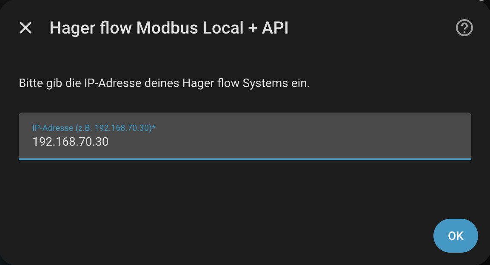
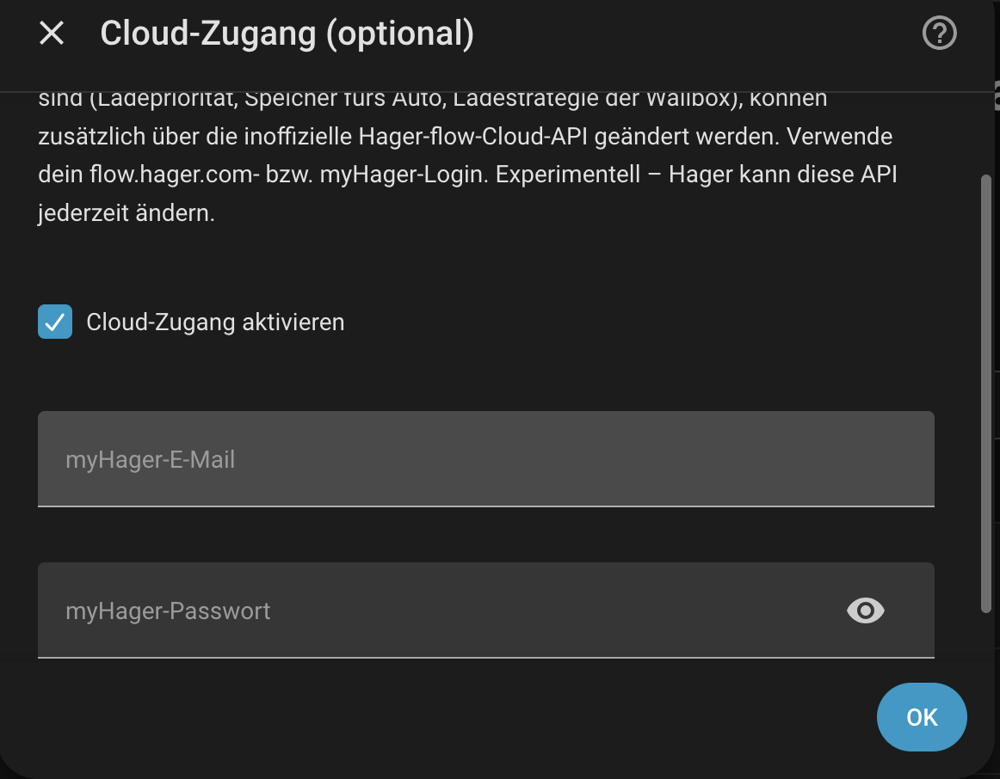

# Hager flow Modbus Local + API — Home Assistant Integration

 
🌐 **Supported System Languages:** `English` | `Deutsch` | `Français` | `Nederlands`

A modern, highly optimized Home Assistant custom integration to monitor and control your **Hager flow Energy Management System (EMS / EMC)** locally over Modbus TCP. It features a strict **Auto-Discovery engine** that automatically maps and dynamically names connected hardware while filtering out offline devices to keep your entities clean.

Reading and most control stay **100 % local** over Modbus. On top of that, an **optional cloud layer** (opt-in, off by default) adds a handful of controls that Hager does **not** expose over Modbus — charging priority, battery-to-car discharge modes, per-wallbox charging strategy, a discharge-down-to-SoC limit, and the emergency power reserve. See [Optional: Cloud Access for Extended Features](#-optional-cloud-access-for-extended-features).

---

## 📋 Prerequisites

To use this integration, your setup must meet the following minimum requirements:

### 🔧 Required Hardware & System Base
* **Base Controller:** **Hager flow XEM470** Energy Management Controller (EMC).
* **Network Access:** The controller must be connected to the same local network as your Home Assistant instance.
* **IP Configuration:** A **static IP address** for the Hager flow controller is highly recommended to prevent connection loss.

### 🔌 Supported Optional Hardware (Hager-only)
⚠️ **Important:** The built-in Auto-Discovery engine only works for **original Hager devices** connected directly to the system.
* **Powermeters:** Additional Hager sub-meters (XVA6xx, ECR38xD).
* **Wallboxes:** Hager witty charging stations (flow, solar, plus).
* **Inverters & Storage:** Connected Hager-supported solar inverters (XEM1200) and battery storage systems (XEM3x00, XEM4x00).
* **Heat Pumps:** SG Ready connection within the systems.

### ⚙️ Software & Network Configuration
* **Home Assistant:** Version **2025.12 or newer** is strictly required.
* **Modbus TCP:** Must be explicitly **enabled** directly within your **Hager flow application**. – if this option is not visible, you may need to contact Hager Support to have it unlocked.
* **Network Port:** **Port 502** must be open and accessible (verify your firewall settings if connection fails).

---

## 📋 Features

- ⚡ **Local-first Control:** Reads and controls your system directly via Modbus TCP (Port 502) — no cloud required for everyday operation.
- ☁️ **Optional Cloud Extensions (opt-in):** For settings Modbus can't write, an optional cloud layer (myHager login) adds **charging priority**, **battery-to-car discharge** (solar & boost mode), per-wallbox **charging strategy**, **discharge down to a state of charge**, and the **emergency power reserve** — the last two safely coupled (the limit never drops below the reserve). Off by default; if the cloud is down, only these entities become unavailable while Modbus keeps running. See [Optional: Cloud Access](#-optional-cloud-access-for-extended-features).
- 🔋 **Home Assistant Energy Dashboard Ready:** Automatically derives `kWh` energy sensors (with correct `total_increasing` state class) from every available power reading — no manual Riemann-sum helper entities required. See [Energy Dashboard Support](#-home-assistant-energy-dashboard-support) below.
- 🌍 **Native Multilingual Support:** Automatically adapts to your Home Assistant system language. Fully translated into **English**, **Deutsch**, **Français**, and **Nederlands** for all entity names, states, and configuration dialogs.
- 📦 **Multi-Hub Support:** Add multiple Hager flow devices with different IP addresses simultaneously without entity conflicts.
- 🧠 **Smart Auto-Discovery (Powermeters):** Scans Slave IDs 30–37 on startup. Dynamically creates entities *only* if a valid text name starting with `EC` (Energy Control) is broadcasted, natively using the device's real name.
- 🚗 **Smart Auto-Discovery (Witty Wallboxes):** Scans Slave IDs 1–7. Dynamically creates diagnostic, energy sensors, and control switches *only* if the connection register (`4613`) confirms active presence (`== 1`).
- 🔄 **Smart Auto-Discovery (SG Ready):** Scans Slave IDs 50–59. Automatically registers heat pumps or thermal systems if a name is broadcasted on register `4098`.
- 🗂️ **Advanced Device Grouping:** Entities no longer land under "Unassigned". The core EMC controller, each Powermeter, each Witty Wallbox, and each SG Ready interface are mapped into **individual devices** with native branding logos.
- 🔠 **Enum Text Mapping:** Cryptic Modbus numbers (like SG Ready states `1-4`, Meter Types `0-8`, or Power Priorities) are dynamically translated into clear, human-readable text.

---

## 📊 Monitored & Controlled Entities

> **Note on language:** Sensor states below (e.g. "Allowed", "Blocked") are shown
> translated into **your Home Assistant profile language**. Entity **names**
> follow the server's system language instead. See [Translations](#-translations)
> below.

### 🏠 Static Main System Sensors (Slave 0)
*   **Total PV Power** (W)
*   **Battery SOC** (State of Charge in % without floating decimals)
*   **Total House Consumption** (W)
*   **Grid Power** (Total Grid Power in W)
*   **Battery Power** (Battery Charge/Discharge in W)
*   **Autarky / Self-Consumption Last Hour** (Hourly statistics in %)
*   **Charging Priority** (Translated state: *Charging station first* / *Battery first*)
*   **Battery Discharge into Car** (Translated state: *Allowed* / *Forbidden*)
*   **Device Info:** System Serial Number, Mainboard Firmware Version
*   🔋 **Total PV Energy, House Consumption Energy** (kWh, derived) — see [Energy Dashboard Support](#-home-assistant-energy-dashboard-support)
*   🔋 **Grid Consumption Energy / Grid Feed-in Energy** (kWh, derived)
*   🔋 **Battery Charge Energy / Battery Discharge Energy** (kWh, derived)

### ⏱️ Dynamic Powermeter Sensors (if detected)
*   **Total Power** (W)
*   **Power L1 / L2 / L3** (Individual Phase Power in W)
*   **Type** (Translated state: *Root Meter*, *Additional Consumer*, *Additional Generation*, *Wallbox*, etc.)
*   🔋 **Energy Consumption / Energy Feed-in** (kWh, derived per meter) — see [Energy Dashboard Support](#-home-assistant-energy-dashboard-support)

### 🔌 Dynamic Witty Wallbox Sensors & Controls (if detected)
*   **Device Info:** Name, Firmware Version, IP Address
*   **Charging Status:** Total Charge / Grid Charge / PV Charge Current Session (all in kWh, natively reported by the wallbox — now correctly exposed as `total_increasing`, so they're selectable in the Energy Dashboard)
*   **Diagnostic Values:** Charging Power (W), Session Badge ID, RFID Card ID, **Connected** (Translated state: *Yes* / *No*)
*   🔋 **Energy Consumption (calculated)** (kWh, derived from the live Charging Power reading — a locally computed cross-check alongside the wallbox's own native kWh counters)
*   **🚀 Boost Mode Switch:** Active writeable control switch (*On* = Full power / *Off* = Eco/Solar mode)

### 🌡️ Dynamic SG Ready Sensors (if detected)
*   **SG Ready Status** (Translated state: *Blocked*, *Normal Operation*, *Start Recommendation*, *Start Command*)

### ☁️ Cloud-only Controls (optional)
Enabling cloud access adds a few write-only controls (charging priority, battery-to-car discharge, charging strategy, discharge limit, emergency reserve). They're listed with all details, limits and the safety coupling under [Optional: Cloud Access for Extended Features](#-optional-cloud-access-for-extended-features).

---

## ⚠️ Write latency & the 30-second click protection

Hager's device confirms a write only after its own state-machine/cloud sync — for the Modbus **Boost switch** (register `4631`) that's up to ~20 s. To avoid flip-flopping and accidental double-clicks, the switch jumps to your target state immediately, then greys out for **30 seconds** before normal polling resumes. The optional [cloud entities](#-optional-cloud-access-for-extended-features) use the same 30-second click protection.

---

## ☁️ Optional: Cloud Access for Extended Features

Modbus stays the main data source — everything is still read locally. A few settings are **not writable via Modbus**; for those you can optionally enable cloud access (see [Configuration](#-configuration)). It adds these controls:

- **Charging priority (cloud)** – *Charging station first / Battery first*
- **Use battery for the car in solar mode (cloud)** ¹
- **Use battery for the car in boost mode (cloud)** ¹
- **Charging strategy (cloud)** – *Solar surplus only / Solar + minimum charge / Solar + target time / Boost charging*
- **Discharge down to state of charge (cloud)** ²
- **Emergency power reserve (cloud)** – in Wh ³

¹ Only usable with charging priority **"Charging station first"**. With "Battery first" the system would reject the change – both switches are then greyed out (unavailable).

² The battery is discharged into the car down to this state of charge. Only usable while discharge is enabled (see ¹), otherwise greyed out. **Range: from the lower bound (reserve % + 10, see ³) up to 100 %.** **0 is not possible** – it would discharge the battery below the emergency reserve; a smaller value is raised to the lower bound automatically. **100 % means no discharge into the car** – the battery is kept entirely for the house. This setting exists only in the E3/DC portal, not in the flow portal.

³ Energy the battery keeps back for emergency power (in Wh). **Coupled to the discharge limit:** the limit can never fall below the reserve and always stays at least 10 % above it. The limit's lower bound is `reserve ÷ (battery modules × 3000 Wh)` + 10 %. Raising the reserve pulls the limit up automatically. Entity attributes show capacity, reserve % and the computed lower bound. Note: setting the reserve can briefly reset the discharge limit to 0 on the device – the integration automatically corrects it back to the lower bound while discharge is enabled.

The Modbus sensors still report the current priority and discharge state; the cloud entities poll once a minute and carry the same **30-second click protection** (a change takes up to ~30 s to travel to the device and back).

> ⚠️ **Experimental and unofficial.** This is the undocumented API behind flow.hager.com and Hager may change it at any time. If the cloud is down, only the cloud entities become unavailable – Modbus keeps running. Accounts with two-factor authentication are not supported. Endpoint details: [docs/cloud-api.md](docs/cloud-api.md). Login flow adapted from [hebrru/Hager-local](https://github.com/hebrru/Hager-local) (MIT).

## 🔋 Home Assistant Energy Dashboard Support

The Hager flow EMC reports most quantities as instantaneous **power** (W), not cumulative **energy** (kWh) — but the Home Assistant Energy Dashboard needs the latter. This integration bridges that gap automatically, without requiring you to set up any `utility_meter` or Riemann-sum helper entities by hand.

### How it works

For every relevant power reading, the integration derives a matching `kWh` sensor using trapezoidal integration on the same 5-second polling cycle already used for regular updates:

*   **Main system** (always present): PV production, house consumption, grid import/export, and battery charge/discharge each get their own derived energy sensor.
*   **Every auto-discovered Powermeter**: gets an `Energy Consumption` and `Energy Feed-in` energy sensor pair, derived from its `Total Power` reading.
*   **Every auto-discovered Wallbox**: gets an additional `Energy Consumption (calculated)` sensor derived from its live Charging Power, alongside the wallbox's own native kWh counters.

New devices found by Auto-Discovery (e.g. after adding an RTU meter or wallbox and reloading the integration) automatically get their own energy sensors too — no code or configuration changes needed.

### Import / export splitting

Signed power readings (grid connection, battery, and generic powermeters, where the sign convention depends on the device role) are split into two separate, always-positive energy sensors — e.g. **Grid Consumption Energy** and **Grid Feed-in Energy** — exactly as the Energy Dashboard expects for grid and battery sources. A sensor for a direction that never occurs (e.g. `Energy Feed-in` on a pure consumer meter) simply stays at `0 kWh`, which is expected and not an error.

### Persistence across restarts

All derived energy sensors use Home Assistant's `RestoreSensor`, so their running totals survive integration reloads and Home Assistant restarts instead of resetting to zero — keeping your daily/weekly/monthly statistics in the Energy Dashboard continuous.

### Setting it up

After updating, go to **Settings → Dashboards → Energy** and assign the new sensors to the matching category (e.g. *Grid consumption* → `Grid Consumption Energy`, *Return to grid* → `Grid Feed-in Energy`, *Solar production* → `Total PV Energy`, *Battery systems* → `Battery Charge/Discharge Energy`).

> [!NOTE]
> Because the sign convention of signed registers isn't documented for every device role, double-check once after setup that e.g. drawing power from the grid increases `Grid Consumption Energy` and not `Grid Feed-in Energy`. If it's reversed for your setup, please open an issue.

---

## 🌍 Translations

All entity names and states are translated. Sensor **names** follow the server's
system language; sensor **states** (e.g. "Allowed", "Blocked") follow each
user's own profile language.

| Language | File |
|---|---|
| 🇩🇪 German | `translations/de.json` |
| 🇬🇧 English (source) | `translations/en.json` |
| 🇫🇷 French | `translations/fr.json` |
| 🇳🇱 Dutch | `translations/nl.json` |

If your language isn't listed, Home Assistant falls back to English.

### Adding a new language

1. Copy `custom_components/hager_flow/translations/en.json` to
   `custom_components/hager_flow/translations/<language-code>.json`
   (e.g. `it.json`, `es.json`) — use a two-letter
   [Home Assistant supported language code](https://www.home-assistant.io/integrations/homeassistant/#supported-languages).
2. Translate only the **values**, never the keys (e.g. `"allowed"`) and never
   placeholders like `{seconds}`.
3. Open a pull request. No code changes are needed — Home Assistant picks up
   the new file automatically.

---

## 🚀 Installation

### Option 1: Via HACS (recommended once stable)

Once accepted into the HACS default store, you'll be able to find and install
**Hager flow Modbus Local + API** directly from HACS → Integrations without adding a
custom repository first.

One-Click Installation: 

1. In Home Assistant open **HACS → Integrations**.
2. Search for **Hager flow Modbus Local + API**
3. Install **Hager flow Modbus Local + API** and restart Home Assistant.

### Option 2: Via HACS Custom Repository (Current Method)
Since this integration is not yet part of the HACS default store, you can easily add it manually as a Custom Repository:

1. In Home Assistant, navigate to **HACS** → **Integrations**.
2. Click the **three dots (⋮)** in the top right corner and select **Custom repositories**.
3. In the **Repository** field, paste the URL of this project:
   `[https://github.com/Winkelhuf/ha-hager-flow]`
4. In the **Type** dropdown, select **Integration**.
5. Click **Add** and wait for HACS to clone the repository.
6. Find the newly listed **Hager flow Modbus Local + API** card, click **Download**, and select the latest version.
7. **Restart** Home Assistant.

### Option 3: Manual Installation (Private Testing)
1. Download the latest release or clone the repository.
2. Copy the inner `hager_flow` folder from `custom_components/` into your Home Assistant's local `config/custom_components/` directory.
3. Your path should look like this: `/config/custom_components/hager_flow/`
4. **Restart** Home Assistant.

---

## ⚙️ Configuration

Setup has two stages: the **local Modbus** connection (all you need for monitoring and most control), and — optionally — **cloud access** for the few extra write functions.

### 1. Local setup (Modbus — required)

1. **Settings → Devices & Services → + Add Integration**, search for **"Hager flow Modbus Local + API"**.
2. Enter only the **IP address** of your XEM470 (preset: `192.168.70.30`) and click **Submit**.
3. Done — Auto-Discovery maps your hardware into clean, per-device entities. Nothing else to fill in.

### 2. Cloud access (optional — settings Modbus can't write)

1. **Settings → Devices & Services → Hager flow → Configure**.
2. Turn on **Enable cloud access** and enter your **myHager** e-mail and password.
3. The matching installation is detected automatically from the EMC serial already read over Modbus.

This adds the [cloud-only controls](#-optional-cloud-access-for-extended-features) (charging priority, battery-to-car, charging strategy, discharge limit, emergency reserve). Toggle it back off anytime via **Configure**.

> [!TIP]
> If you change physical RS485 wiring (adding/removing meters or wallboxes), reload the integration or restart Home Assistant to re-run Auto-Discovery.

---

## 🛠️ Tech Stack & Architecture

- Async **`DataUpdateCoordinator`**, polling grouped register blocks every 5 seconds.
- Built for **Pymodbus 3.9–3.11** on **Python 3.12–3.14**; decoding via native `convert_from_registers`.
- Unique IDs namespaced per config entry (`entry.entry_id`), so multiple installations never collide.
- Brand assets served locally from `/brand` — no external calls.
- Optional cloud layer: separate coordinator and config-entry options; a cloud outage never affects Modbus.

---

## Built with AI

This repository was developed with significant assistance from AI coding assistants (Gemini, Claude). We believe that community integrations may benefit from extensive AI assistance when their actual review, testing, limitations, and maturity are communicated honestly. These safeguards improve verifiability but do not guarantee correctness.

---

## Disclaimer

This integration is not affiliated with or endorsed by Hager. "hager" and "flow" are trademarks of their respective owners. Use at your own risk.

---

## 📜 License

This project is licensed under the MIT License - see the [LICENSE](LICENSE) file for details.
